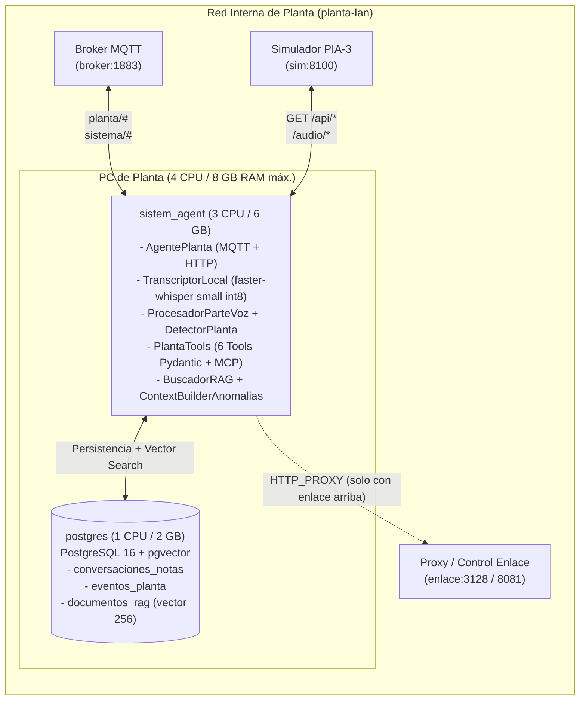

# Sistema de Agentes para Planta de Inyección de Agua PIA-3 — Entrega 1

Solución para la **Entrega 1** del Trabajo Práctico de la Academia Novit 2026 (`agustin-volpe`). Implementa el sistema de planta que procesa los partes de recorrida por voz, interactúa con el operador en la tablet, monitorea sensores en tiempo real, emite alertas de seguridad en menos de 30 segundos reales aun sin enlace de datos, indexa el corpus técnico e histórico en **PostgreSQL 16 + `pgvector`** y construye el contexto enriquecido para el análisis de anomalías.

---

## 1. Arquitectura del Sistema



### Estructura del Proyecto (`src/` layout)

```text
agustin-volpe/
├── Dockerfile                              # Imagen Python 3.11-slim + planta_contrato + faster-whisper offline
├── docker-compose.yml                      # Servicios sistem_agent (3 CPU/6G) y postgres pgvector (1 CPU/2G)
├── pyproject.toml                          # Empaquetado PEP 621 y dependencias fijadas
├── README.md                               # Documentación de arquitectura, decisiones y ejecución
├── INFORME.md                              # Informe de modelos locales, recursos, métricas RAG y partes
├── docs/
│   ├── spec-flujo-parte.md                 # Especificación paso a paso del flujo del Parte por Voz (1.2)
│   └── politica-memoria.md                 # Política de memoria: conversación vs historial vs RAG (2.4)
├── src/sistema/
│   ├── config.py                           # Configuración centralizada con pydantic-settings
│   ├── agente.py                           # Loop principal, latido MQTT, timeout y coordinación
│   ├── dominio/
│   │   └── deteccion.py                    # Detección determinista S1-S4 (<30s), límites y sensores (B1-B3)
│   ├── integraciones/
│   │   ├── mqtt_cliente.py                 # Cliente MQTT validado con modelos de planta_contrato
│   │   ├── planta_api.py                   # Cliente HTTP con reintentos, backoff y carga de datos de planta
│   │   ├── tools.py                        # 6 Tools de solo lectura con ConfigDict(extra="forbid") (1.3)
│   │   └── mcp_server.py                   # Servidor MCP exponiendo las tools de la planta (1.3)
│   ├── persistencia/
│   │   └── repositorio.py                  # Estado de conversación por nota y cola offline en PostgreSQL (2.4)
│   ├── procesamiento/
│   │   ├── transcripcion.py                # STT local con faster-whisper (small, int8 en CPU)
│   │   ├── parte_voz.py                    # Extracción de filas, desambiguación y correcciones (A1-A4b)
│   │   └── analisis.py                     # ContextBuilderAnomalias: Tools + RAG con citas (2.3)
│   └── rag/
│       ├── indexador.py                    # Enriquecimiento de metadatos e indexación en pgvector (2.1)
│       └── buscador.py                     # Búsqueda híbrida BM25 + pgvector + grafo de citas (2.2)
├── evaluacion/
│   ├── evaluar_rag.py                      # Evaluación cuantitativa sobre retrieval.json (71 preguntas)
│   └── evaluar_partes.py                   # Evaluación de extracción de partes de voz y detección
└── tests/
    ├── test_tools.py                       # Tests de las 6 tools, Pydantic estricto, reintentos y MCP
    ├── test_deteccion.py                   # Tests de alertas S1-S4, conversión psi/bar y sensores
    ├── test_parte_voz.py                   # Tests de números hablados, ambigüedades y correcciones
    └── test_rag.py                         # Tests de indexación pgvector, exclusión Rev. C y Context Builder
```

---

## 2. Decisiones de Diseño y Justificación

### 2.1. ¿Qué corre en la PC de planta y qué sale por el enlace? (Sección 1.1)

En la planta PIA-3 el radioenlace hacia el exterior (`http://enlace:3128`) se corta con frecuencia por viento fuerte (condición **P1**, escenario `fuga-sin-enlace`) y la energía eléctrica puede caer y volver (condición **P2**, escenario `corte-energia`). Por lo tanto:

1. **Corre 100% en la PC de planta (sin depender del enlace)**:
   - **Transcripción de audio (`TranscriptorLocal`)**: ejecuta `faster-whisper` (`small`, cuantizado en `int8`) con los pesos pre-descargados en `/opt/whisper` dentro de la imagen Docker.
   - **Detección de condiciones inseguras (`S1` a `S4`)**: se evalúa en código determinista (`DetectorPlanta.evaluar_seguridad_nota`) apenas se transcribe la nota, publicando `EventoSistema(tipo="AlertaSeguridad")` y `MensajeTablet(espera_respuesta=False)` en menos de 1 segundo real (muy por debajo del límite de **30 segundos reales** exigido por la rúbrica `B1a`, incluso con el enlace caído).
   - **Flujo del Parte por Voz y diálogo con la Tablet (`ProcesadorParteVoz`)**: la extracción de filas `FilaParte`, la resolución de nombres de campo, la detección de ambigüedades y las preguntas/confirmaciones en la tablet (`sistema/tablet`) ocurren íntegramente en la red `planta-lan`.
   - **Monitoreo de sensores y clasificación `SinNovedad` / `Escalado`**: la conversión de unidades (`psi` y `bar` $\rightarrow$ `kg/cm2`), la comparación contra los límites oficiales de `GET /api/planta` y el filtrado de picos aislados en sensores corren en código puro en el contenedor local.
   - **Persistencia transaccional e índice RAG (`PostgreSQL 16 + pgvector`)**: tanto el estado de cada conversación por nota (`conversaciones_notas`) como los eventos generados (`eventos_planta`) y los vectores del corpus (`documentos_rag`) residen en el contenedor local `postgres`.
2. **Qué pasa cuando se corta el enlace (`enlace:8081/estado`)**:
   - Cuando el enlace está caído (`arriba: false`), los eventos `Escalado` que requieren sincronización externa quedan persistidos en PostgreSQL con `sincronizado = FALSE` y el agente informa la cantidad exacta en el campo `pendientes_sincronizar` del latido periódico `sistema/estado` (cada 25 s).
   - En cuanto el enlace vuelve a estar disponible (`arriba: true`), el agente marca los eventos pendientes como sincronizados en orden cronológico sin duplicarlos y restablece `pendientes_sincronizar = 0`.

### 2.2. ¿Qué entra por consulta directa (Tools / API) y qué entra por RAG? (Secciones 1.3 y 2.3)

En un sistema industrial es un error usar búsqueda vectorial (RAG) para datos tabulares exactos o estados cambiantes en tiempo real. En `ContextBuilderAnomalias` (`src/sistema/procesamiento/analisis.py`) separamos estrictamente ambas fuentes:

| Información requerida | Vía de obtención | Justificación técnica |
|---|---|---|
| **Límites de alarma y disparo, unidad de manómetro local y nombres de campo** | **Consulta directa** (`consultar_equipos` $\rightarrow$ `GET /api/planta`) | Los límites son umbrales numéricos exactos configurados en el sistema de control; buscarlos por embeddings expone al riesgo de recuperar límites de otros modelos (`TX-250`) o del manual vencido (`TX350-C`). |
| **Tendencia y rango histórico de sensores (45 días)** | **Consulta directa** (`consultar_historial_sensores` $\rightarrow$ `GET /api/historian/{tag}/{var}`) | Son series temporales numéricas donde se requiere calcular mínimo, máximo, promedio reciente y pendiente en código determinista. |
| **Stock en tiempo real en el yacimiento, costos en USD y BOM por equipo** | **Consulta directa** (`consultar_inventario_y_bom`) | El stock cambia a medida que se ejecutan órdenes y las reglas de aprobación automática requieren cantidades exactas en el almacén del yacimiento (`MBP-4 §12.3`). |
| **Catálogo de tareas estándar y no estándar (duración, ejecutor, si detiene)** | **Consulta directa** (`consultar_catalogo_tareas`) | Estructura finita y normativa que define si una tarea es estándar o requiere contratista (`Servipat`). |
| **Diagnóstico por síntoma, árboles de decisión y procedimientos paso a paso (`P-01`..`P-11`, `FP-01`..`FP-06`)** | **RAG Híbrido** (`BuscadorRAG` sobre `TX350-D`, `FC48-3`, `MBP-4`) | Conocimiento técnico en prosa donde el operador describe síntomas con vocabulario variable ("ruido a piedras", "aceite café con leche", "chirrido al arrancar") y se requiere recuperar la sección con su cita canónica (`"TX350-D §8.9"`, `"MBP-4 §6.11"`). |
| **Hallazgos de causa raíz en órdenes históricas cerradas (`OT-24-...` a `OT-26-...`)** | **RAG Híbrido + API** (`BuscadorRAG` + `consultar_historial_ordenes`) | Las notas de cierre antes de 2025 tienen texto libre con abreviaturas y errores de tipeo ("embolo 3 rayado", "ramal de succoin mas largo", "2 cartuchos partidos"). El RAG permite encontrar casos análogos por síntoma y equipo con su cita (`"historial OT-25-0059"`). |

---

## 3. Instrucciones de Ejecución y Pruebas

### 3.1. Levantar el simulador de la planta (repositorio base)

En una terminal, levantar los servicios de la planta (crea la red Docker externa `planta-lan`):

```powershell
cd "D:\Cursos\Curso software agentico\academia2026-tp"
docker compose up -d
```

- Panel web del simulador y visor de recorridas/tablet: `http://localhost:8100`

### 3.2. Construir y levantar nuestro sistema de agentes

En otra terminal, dentro de este repositorio (`agustin-volpe`):

```powershell
cd "D:\Cursos\Curso software agentico\agustin-volpe"
cp .env.example .env
docker compose up -d --build
```

Verificar que el agente esté publicando su latido cada 25 segundos en `sistema/estado`:

```powershell
curl http://localhost:8100/api/registro?topico=sistema/estado
```

### 3.3. Ejecutar la suite de tests automatizados (24 tests)

```powershell
docker compose exec -e PYTHONPATH=/app/src:/app sistem_agent pytest -v /app/tests
```

### 3.4. Ejecutar las evaluaciones de RAG y de Partes de Voz

```powershell
# Evaluación RAG sobre las 71 preguntas oficiales (comparativa Baseline BM25 vs BuscadorRAG)
docker compose exec -e PYTHONPATH=/app/src:/app sistem_agent python -m evaluacion.evaluar_rag

# Evaluación de extracción de partes de voz, ambigüedades y alertas de seguridad
docker compose exec -e PYTHONPATH=/app/src:/app sistem_agent python -m evaluacion.evaluar_partes
```

### 3.5. Ejecutar el corrector oficial de la cátedra

Desde el repositorio base de la planta (`academia2026-tp`):

```powershell
cd "D:\Cursos\Curso software agentico\academia2026-tp"
python -m correccion.corregir --compose "D:\Cursos\Curso software agentico\agustin-volpe\docker-compose.yml" --escenarios martes-tranquilo fuga-sin-enlace --aceleracion 30
```
