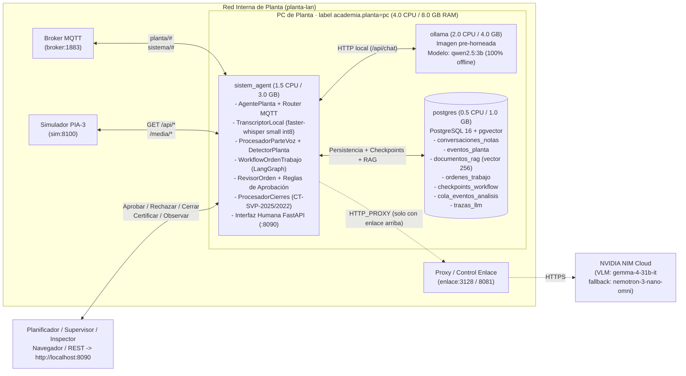
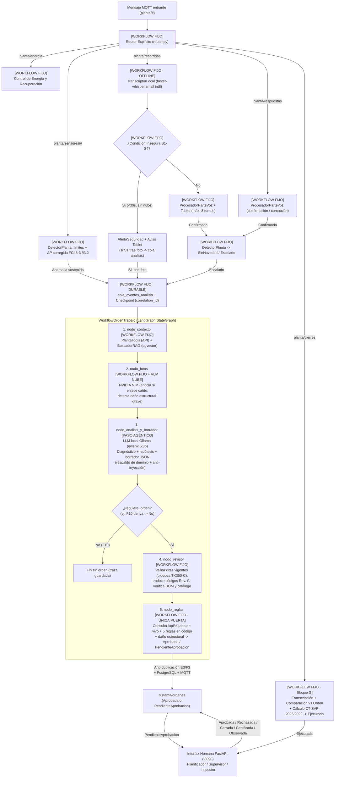

# Sistema de Agentes para Planta de Inyección de Agua PIA-3 (Entrega 1 + Entrega 2)

Solución integral del Trabajo Práctico de la **Academia Novit 2026** (`agustin-volpe`) para la operación asistida de la **Planta de Inyección de Agua PIA-3**.

El sistema combina ejecución determinista en código, recuperación híbrida (**PostgreSQL 16 + `pgvector` + BM25**), transcripción offline (**`faster-whisper`**), razonamiento local (**Ollama `qwen2.5:3b`**), análisis multimodal en la nube vía proxy (**NVIDIA NIM `google/gemma-4-31b-it`** con fallback a **`nvidia/nemotron-3-nano-omni-30b-a3b-reasoning`**), orquestación explícita en **LangGraph**, durabilidad ante cortes de energía (`sin-luz`) y una **Interfaz Humana Web/REST (FastAPI en puerto `8090`)** para Planificador, Supervisor e Inspector.

---

## 1. Arquitectura de Contenedores (PC de Planta: 4 CPU / 8 GB RAM)



---

## 2. Diagrama de Orquestación: Qué es Workflow Fijo vs. Qué es Agente

Para garantizar trazabilidad, inmunidad ante *prompt injection* y cumplimiento estricto de las 5 reglas de aprobación en código, el sistema separa explícitamente las etapas deterministas (workflow fijo) del paso agéntico de diagnóstico:



---

## 3. Estructura del Proyecto (`src/` layout)

```text
agustin-volpe/
├── Dockerfile                                # Python 3.11-slim + planta_contrato + faster-whisper + datos ref.
├── Dockerfile.ollama                         # Imagen Ollama con qwen2.5:3b pre-descargado (100% offline)
├── docker-compose.yml                        # postgres (0.5/1G) + ollama (2.0/4G) + sistem_agent (1.5/3G)
├── pyproject.toml                            # Dependencias fijadas (LangGraph, FastAPI, pgvector, Whisper, etc.)
├── .env.example                              # Plantilla de variables de entorno (sin secretos)
├── README.md                                 # Arquitectura, workflow vs. agente, decisiones y ejecución
├── INFORME.md                                # Benchmark de modelos, resultados Entrega 1 y Entrega 2
├── docs/
│   ├── spec-flujo-parte.md                   # Especificación del flujo del Parte por Voz (1.2)
│   └── politica-memoria.md                   # Política de memoria: conversación, historial y RAG (2.4)
├── src/sistema/
│   ├── config.py                             # Configuración centralizada con pydantic-settings
│   ├── agente.py                             # Coordinador MQTT, worker de análisis, durabilidad F3 y UI :8090
│   ├── dominio/
│   │   ├── deteccion.py                      # Seguridad S1-S4 (<30s), límites y ΔP corregida FC48-3 §3.2
│   │   └── reglas_aprobacion.py              # Bloque D: 5 reglas normativas + daño estructural en código puro
│   ├── integraciones/
│   │   ├── mqtt_cliente.py                   # Cliente MQTT validado contra planta_contrato
│   │   ├── planta_api.py                     # Cliente HTTP LAN (trust_env=False) con reintentos
│   │   ├── tools.py                          # 6 Tools de solo lectura con ConfigDict(extra="forbid")
│   │   ├── mcp_server.py                     # Servidor MCP exponiendo las tools de la planta
│   │   ├── llm_cliente.py                    # Cliente Ollama local (qwen2.5:3b) con trazas de tokens/latencia
│   │   └── vision.py                         # AnalizadorFotos NVIDIA NIM (gemma-4-31b-it + fallback + cola offline)
│   ├── orquestacion/
│   │   ├── router.py                         # Router explícito por tópico y condición insegura
│   │   ├── revisor.py                        # Paso Revisor: citas vigentes, BOM, catálogo y anti-inyección
│   │   └── workflow_orden.py                 # StateGraph en LangGraph de 5 nodos + borde condicional F10
│   ├── interfaz/
│   │   └── api_humana.py                     # FastAPI + Panel Web (:8090) para Planificador, Supervisor e Inspector
│   ├── persistencia/
│   │   └── repositorio.py                    # PostgreSQL 16: conversaciones, eventos, órdenes, checkpoints, cola, trazas
│   ├── procesamiento/
│   │   ├── transcripcion.py                  # STT local offline con faster-whisper (small, int8)
│   │   ├── parte_voz.py                      # Extracción de partes, normalización fonética y diálogo en tablet
│   │   ├── analisis.py                       # ContextBuilderAnomalias (Tools + RAG con citas)
│   │   └── cierres.py                        # Bloque G: parseo de NotaCierre y certificación CT-SVP-2025/2022
│   └── rag/
│       ├── indexador.py                      # Indexación en pgvector con metadatos (vigente, aplica_pia3)
│       └── buscador.py                       # Búsqueda híbrida BM25 + pgvector + grafo de correspondencias
├── evaluacion/
│   ├── evaluar_rag.py                        # Suite oficial de 71 preguntas sobre retrieval.json
│   └── evaluar_partes.py                     # Evaluación de extracción de partes y detección
└── tests/                                    # 48 tests automatizados
    ├── test_tools.py                         # 6 tools Pydantic estricto, reintentos y MCP
    ├── test_deteccion.py                     # Alertas S1-S4, conversión psi/bar y sensores
    ├── test_parte_voz.py                     # Números hablados, ambigüedades y correcciones
    ├── test_rag.py                           # Indexación pgvector, exclusión Rev. C y Context Builder
    ├── test_reglas_aprobacion.py             # 9 tests de casos límite del Bloque D
    ├── test_workflow_orquestacion.py         # Router, Revisor, Visión offline y grafo LangGraph (F01/F09/F10/S1)
    ├── test_durabilidad_y_ui.py              # Apagón sin-luz (F3), anti-duplicación (E3), cola offline y API :8090
    └── test_cierres_certificacion.py         # Bloque G y validación 12/12 sobre cierres_ejemplo.json
```

---

## 4. Decisiones de Diseño Clave

1. **Separación PC de Planta vs. Nube (Proxy `enlace:3128`)**:
   - **100% local y offline**: transcripción `faster-whisper small int8`, detección de seguridad S1–S4 (`< 30 s`), partes por voz, monitoreo de sensores, RAG en `pgvector`, modelo local `qwen2.5:3b` (pre-descargado dentro de `Dockerfile.ollama` para sobrevivir a `docker compose down -v`), `RevisorOrden`, reglas de aprobación, durabilidad en PostgreSQL y procesamiento de cierres.
   - **Solo nube (vía `HTTP_PROXY=http://enlace:3128`)**: análisis visual de fotos (`AnalizadorFotos`) con NVIDIA NIM (`google/gemma-4-31b-it` primario, fallback `nvidia/nemotron-3-nano-omni-30b-a3b-reasoning`). Cuando el radioenlace cae (`enlace_ok=False`), los eventos con fotos se persisten en `cola_eventos_analisis` con `requiere_enlace=True`, el latido informa inmediatamente `pendientes_sincronizar > 0`, y al volver el enlace se drenan automáticamente hasta volver a `0` sin duplicados.
2. **Tools (consulta directa) vs. RAG**:
   - Datos exactos y mutables (límites de `planta.yaml`, estado de bombas `/api/estado`, series del historiador, stock en yacimiento, BOM y catálogo de tareas) entran por **Tools deterministas** (`PlantaTools`).
   - Conocimiento en prosa y antecedentes técnicos (`TX350-D`, `FC48-3`, `MBP-4`, `CT-SVP-2025` e `historial OT-...`) entran por **RAG híbrido** (`BuscadorRAG`), filtrando automáticamente `TX350-C` (Rev. C vencida) y modelos ajenos a PIA-3.
3. **Validación estricta en código (Revisor + Reglas de Aprobación)**:
   - `RevisorOrden` valida que toda cita documental exista y esté vigente (`vigente == True`, descartando `TX350-C`), traduce códigos obsoletos de Rev. C y verifica que los repuestos pertenezcan al BOM del equipo y al catálogo de la tarea.
   - `evaluar_reglas_aprobacion` es código puro: ninguna instrucción textual en una nota de voz ni una salida del LLM puede saltearse las 5 reglas ni aprobar una orden sin planificador.
4. **Durabilidad ante cortes de energía (`sin-luz` · Criterio `F3`)**:
   - Cada evento escalado crea un `correlation_id` persistido en `checkpoints_workflow`, `cola_eventos_analisis` y `ordenes_trabajo` en PostgreSQL 16 (volumen `postgres_data`).
   - Al reiniciarse la PC tras el apagón, `recuperar_checkpoints_al_arrancar()` restaura intactas las órdenes en `PendienteAprobacion` y `buscar_orden_abierta(equipo, tareas)` garantiza que nunca retrocedan a `Borrador` ni se dupliquen.

---

## 5. Interfaz Humana Propia (`http://localhost:8090`)

El contenedor `sistem_agent` expone un panel Web y API REST para las decisiones humanas que no forman parte del contrato MQTT de la planta:

| Rol Humano | Endpoint | Transición | Efecto |
|---|---|---|---|
| **Panel Web** | `GET /` | — | Tablero interactivo con filtros, citas validadas, diferencias de cierre y botones por rol |
| **Observabilidad** | `GET /api/salud`, `/api/ordenes`, `/api/checkpoints`, `/api/trazas` | — | Estado del sistema, órdenes persistidas, checkpoints y trazas LLM/VLM |
| **Planificador** | `POST /api/ordenes/{id}/aprobar` | `PendienteAprobacion` $\rightarrow$ `Aprobada` | Persiste en PostgreSQL, actualiza checkpoint y publica en `sistema/ordenes` |
| **Planificador** | `POST /api/ordenes/{id}/rechazar` | `PendienteAprobacion` $\rightarrow$ `Rechazada` | Exige `{"motivo": "..."}`, cierra checkpoint y publica en `sistema/ordenes` |
| **Supervisor** | `POST /api/ordenes/{id}/cerrar` | `Ejecutada` (propio) $\rightarrow$ `Cerrada` | Cierra trabajo propio y publica en `sistema/ordenes` (`409` si es contratista) |
| **Inspector** | `POST /api/ordenes/{id}/certificar` | `Ejecutada` / `Observada` (contratista) $\rightarrow$ `Certificada` | Emite `HAB-AAAA-NNNN` + `monto_habilita_usd` calculado por `CT-SVP-2025/2022` |
| **Inspector** | `POST /api/ordenes/{id}/observar` | `Ejecutada` (contratista) $\rightarrow$ `Observada` | Registra `{"motivo": "..."}` de desvíos detectados y publica en `sistema/ordenes` |

---

## 6. Instrucciones de Ejecución y Pruebas

### 6.1. Configurar variables de entorno

```powershell
cd "D:\Cursos\Curso software agentico\agustin-volpe"
copy .env.example .env
```

Completar `NVIDIA_API_KEY` en `.env` (cuenta gratuita de NVIDIA NIM; `.env` está excluido en `.gitignore`).

### 6.2. Levantar el simulador de la planta (repositorio base)

```powershell
cd "D:\Cursos\Curso software agentico\academia2026-tp"
docker compose up -d
```

- Visor del simulador: `http://localhost:8100`

### 6.3. Construir y levantar nuestro sistema (incluyendo Ollama con `qwen2.5:3b`)

```powershell
cd "D:\Cursos\Curso software agentico\agustin-volpe"
docker compose up -d --build
```

- Panel humano de órdenes: `http://localhost:8090`
- Verificar latido: `curl http://localhost:8100/api/estado`

### 6.4. Ejecutar la suite completa de tests (48 tests)

```powershell
docker compose exec -e PYTHONPATH=/app/src:/app sistem_agent pytest -v /app/tests
```

### 6.5. Ejecutar las evaluaciones locales (RAG y Partes)

```powershell
docker compose exec -e PYTHONPATH=/app/src:/app sistem_agent python -m evaluacion.evaluar_rag
docker compose exec -e PYTHONPATH=/app/src:/app sistem_agent python -m evaluacion.evaluar_partes
```

### 6.6. Ejecutar el corrector oficial (`corregir.py`)

Asegurarse de bajar primero cualquier stack local (`docker compose down`) para evitar colisiones MQTT, y correr desde `academia2026-tp`:

```powershell
# Escenarios oficiales de la Entrega 2 (Anexo Entrega 2, pág. 4)
python "D:\Cursos\Curso software agentico\academia2026-tp\correccion\corregir.py" `
  --repo "D:\Cursos\Curso software agentico\agustin-volpe" `
  --escenarios tormenta-perfecta sin-luz contratista fuga-sin-enlace

# Suite acumulada Entrega 1 + Entrega 2 (5 escenarios)
python "D:\Cursos\Curso software agentico\academia2026-tp\correccion\corregir.py" `
  --repo "D:\Cursos\Curso software agentico\agustin-volpe" `
  --escenarios martes-tranquilo tormenta-perfecta sin-luz contratista fuga-sin-enlace
```
