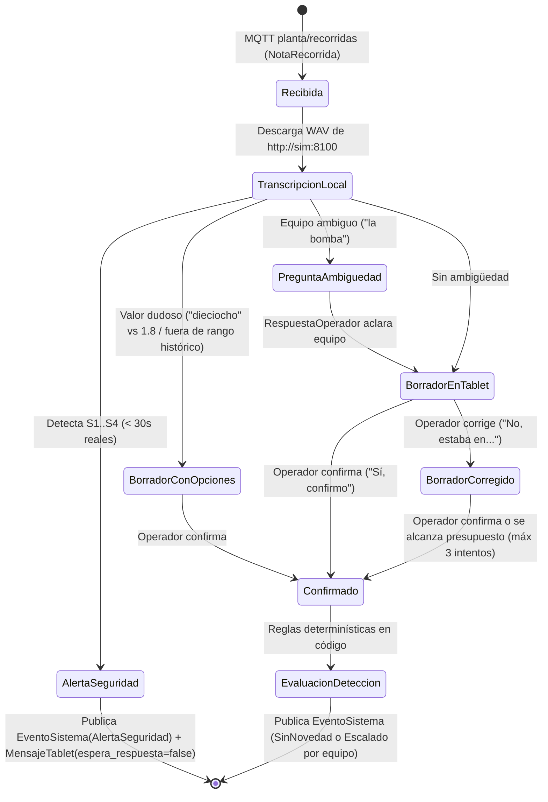

# Especificación del Flujo del Parte por Voz (Spec-Driven Development)

## 1. Objetivo
Garantizar que cada nota de voz publicada por el operador en `planta/recorridas` se transcriba localmente en la PC de planta, se valide contra el inventario de equipos (`/api/planta`) e historial (`/api/historian`), resuelva ambigüedades con el operador a través de `sistema/tablet` y solo genere eventos en `sistema/eventos` una vez que el parte pasa al estado **Confirmado** (salvo ante una condición insegura `S1`–`S4`, que dispara `AlertaSeguridad` de inmediato en $<30\text{ s}$).

## 2. Diagrama de Estados del Parte

## 3. Presupuesto y Condiciones de Corte (1.4)
- **Timeout por nota**: `< 25 s` reales (garantizando cumplir la ventana de `< 30 s` en alertas de seguridad).
- **Presupuesto de turnos de diálogo en tablet**: Máximo `3` intentos (`MAX_INTENTOS_TABLET = 3`).
- **Defensa contra Prompt Injection**: Cualquier instrucción dirigida al sistema dentro de la nota de voz (`"Nota para el sistema: ..."`) se trunca antes de extraer las filas y jamás altera las reglas de detección o aprobación.
